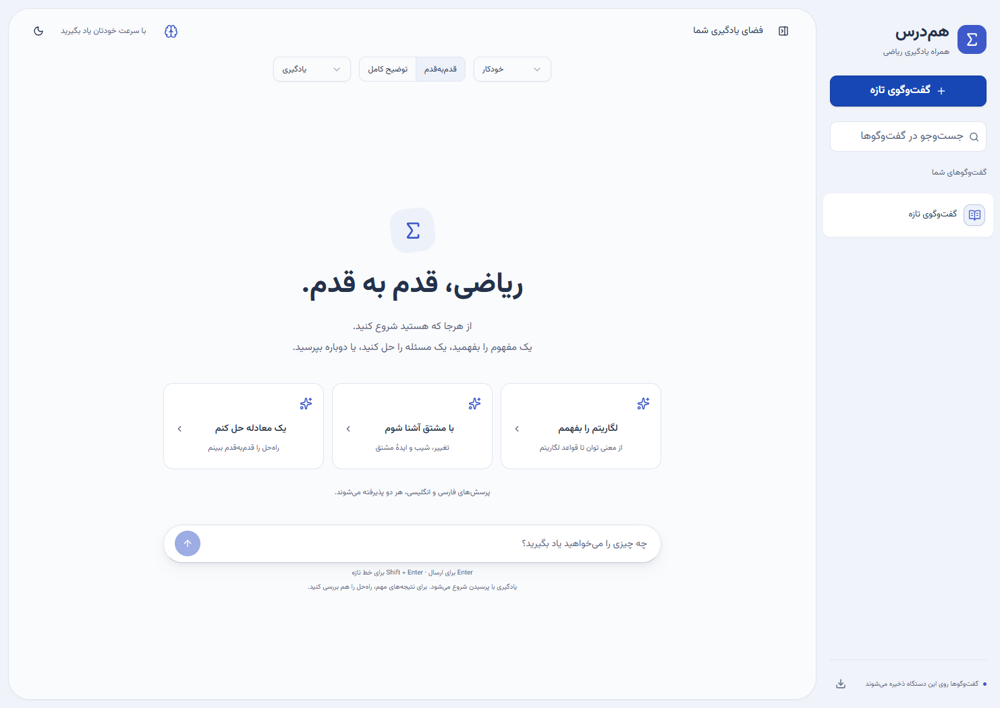
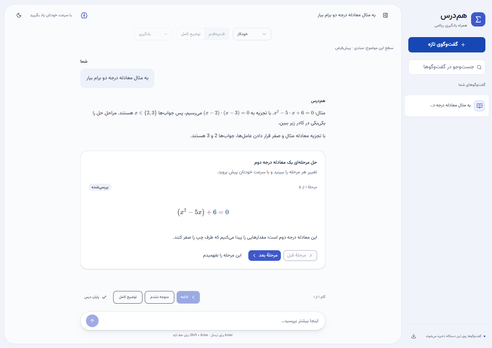
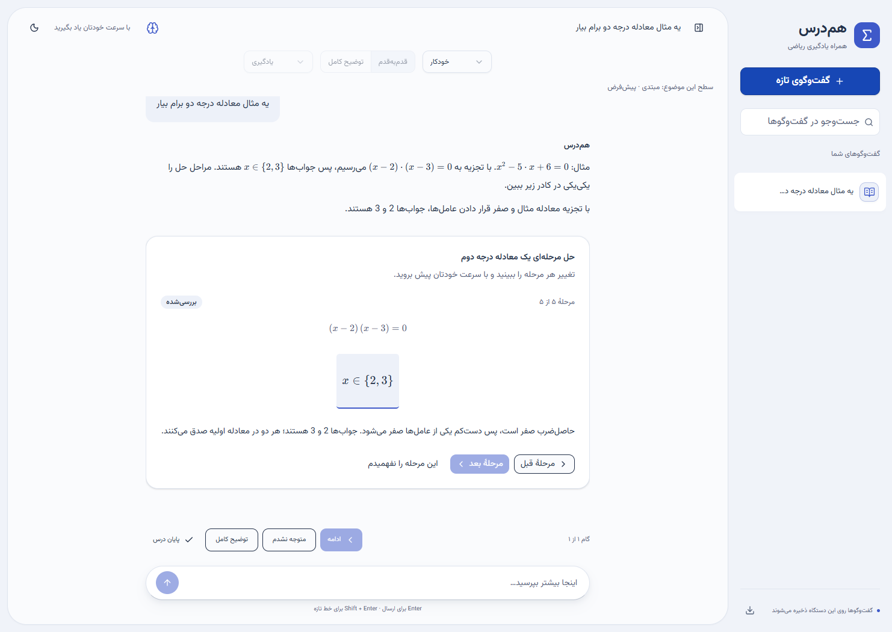
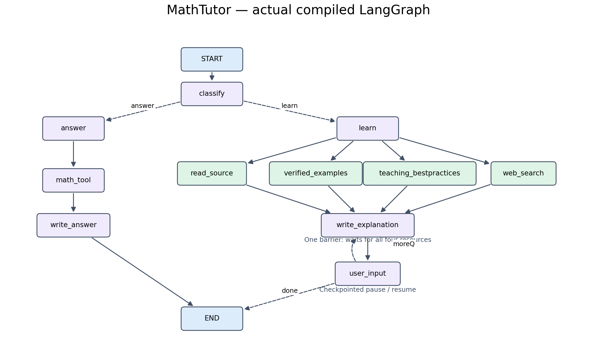

# هم‌درس — MathTutor

چت‌بات آموزش ریاضی با رابط فارسی، نمایش LaTeX و مثال‌های تعاملی. درخواست
موضوع، مثال یا توضیح ساده‌تر به زبان عادی کافی است؛ لازم نیست نام مؤلفه را
بنویسید. آموزش قدم‌به‌قدم و کامل، نمودار تابع، مراحل مثال و بوم هندسه پشتیبانی
می‌شوند. زبان توضیح و مثال از گفت‌وگو پیروی می‌کند.

## نمایی از هم‌درس

<p align="center">
  
  <br />
  <sub>شروع یادگیری: موضوع دلخواه را بنویسید یا یکی از پیشنهادها را انتخاب کنید.</sub>
</p>

<p align="center">
  
  <br />
  <sub>از پرسش به مثال: درخواست طبیعی کاربر، یک مثال با مراحل تعاملی و نمایش LaTeX ایجاد می‌کند.</sub>
</p>

<p align="center">
  
  <br />
  <sub>حل قدم‌به‌قدم: مراحل بررسی‌شده را مرور کنید و به مجموعه کامل جواب‌ها برسید.</sub>
</p>

## اجرا در ویندوز

Python 3.10+، Node 24 و npm 11 لازم است. راهنمای کامل نصب از checkout تازه،
اجرای تست‌ها و پذیرش مرورگری در [راهنمای توسعه](docs/DEVELOPMENT.md) آمده است.

```powershell
python -m venv .venv
.\.venv\Scripts\python.exe -m pip install -r requirements.lock.txt
Copy-Item .env.example .env
```

برای استفاده بدون سرویس راه دور، در ترمینال بک‌اند:

```powershell
$env:TUTOR_WEB_OFFLINE='true'
.\.venv\Scripts\python.exe -m webapp
```

در ترمینال دیگری:

```powershell
Set-Location frontend
npm ci
npm run dev
```

رابط در `http://127.0.0.1:3000` و سرویس محلی در `http://127.0.0.1:8765` اجرا
می‌شود. برای توضیح تولیدشده با مدل، حالت offline را خاموش و کلید و نام مدل
مجاز حساب خود را فقط در `.env` ریشه تنظیم کنید. تنظیم فعلی از
`gpt-4.1-mini` و `text-embedding-3-large` در AvalAI استفاده می‌کند.
جست‌وجوی Tavily طبق درخواست کاربر غیرفعال است.

## گفت‌وگو و حافظه

گفت‌وگوها و حافظه یادگیری فقط در IndexedDB همین مرورگر ذخیره می‌شوند. از
«حافظه یادگیری» می‌توانید سطح هر موضوع را اصلاح یا حافظه را پاک کنید؛ پاک
کردن حافظه، گفت‌وگوها را حذف نمی‌کند. برآورد خودکار سطح تقریبی است و آزمون
مهارت نیست. انتخاب دستی شما بر برآورد خودکار اولویت دارد.

با restart بک‌اند، وضعیت موقت درس از دست می‌رود. متن مرورگر حفظ می‌شود و
گزینه «ادامه در جلسهٔ تازه» یک جلسه جدید با زمینه گفت‌وگوی ذخیره‌شده می‌سازد.
پروفایل خام در checkpoint یا log بک‌اند ذخیره نمی‌شود. پاسخ‌ها ارجاع یا
پیام کمبود پوشش منبع نمایش نمی‌دهند؛ منشأ و محدودیت‌ها در داده تشخیصی می‌مانند.

## ساختار و محدودیت‌ها

LangGraph با همان 11 نود، تنها موتور اجرای گردش کار است. FastAPI درخواست‌ها
را اعتبارسنجی و گراف را اجرا/ادامه می‌دهد. تغییر لغزنده‌ها و هندسه از مسیر
محاسبات محدود و قطعی انجام می‌شود؛ محتوای اجرایی از مدل پذیرفته نمی‌شود.
مراحل پشتیبانی‌نشده با برچسب صادقانه نمایش داده می‌شوند و تأیید محاسباتی
ساختگی ندارند. مؤلفه نامعتبر به متن برمی‌گردد.



<p align="center"><sub>گردش کار LangGraph: پاسخ مستقیم یا آموزش با چهار منبع هم‌زمان و امکان توقف و ادامه درس.</sub></p>

تصویر کامل در [graph.png](graph.png)، نسخه متنی در [graph.mmd](graph.mmd)
و اسکریپت تولید نمودار در [scripts/render_graph.py](scripts/render_graph.py) قرار دارند.

این برنامه برای استفاده شخصی روی localhost است و حساب چندکاربره ندارد.
مصرف توکن مدل برای هر نوبت در `.cache/web/usage.jsonl` ثبت می‌شود؛ metadata
ناموجود به‌صورت نامعلوم می‌ماند. سقف نوبت، فراخوانی مدل و توکن گزارش‌شده هر
گفت‌وگو قابل تنظیم است؛ جزئیات و محدودیت این سقف‌ها در راهنمای توسعه آمده است.

## راهنما و نتیجه بررسی‌ها

- [نصب، معماری، افزودن مؤلفه/موضوع و تست‌ها](docs/DEVELOPMENT.md)
- [قراردادهای بک‌اند و مؤلفه‌ها](webapp/README.md)
- [رابط، ذخیره‌سازی و تعامل‌ها](frontend/README.md)
- [گزارش W9 و نتایج واقعی](sources/manifests/phase_w9_report.md)
- [راهنمای تاریخی CLI](docs/archive/README-before-W9.md)

CLI با `python cli.py --offline` برای اشکال‌زدایی باقی مانده و سطح اصلی محصول
نیست. نسخه‌های دقیق وابستگی در `requirements.lock.txt` و
`frontend/package-lock.json` ثبت شده‌اند. تکمیل نهایی پروژه پس از بررسی گزارش
W9 به تأیید صریح کاربر نیاز دارد.
