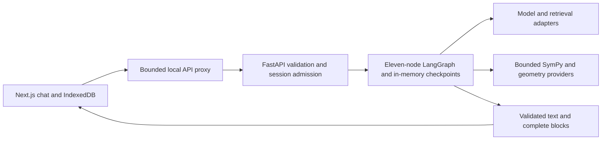

# MathTutor development and acceptance

The product is the Persian-first web app at `http://127.0.0.1:3000`.
FastAPI on 8765 validates requests and invokes the existing eleven-node
LangGraph. The CLI is a debugging tool; its former product guide is preserved
in [the historical README](archive/README-before-W9.md).

## Windows setup from a clean checkout

Use Python 3.10 or newer, Node 24 and npm 11. From the repository root:

```powershell
python -m venv .venv
.\.venv\Scripts\python.exe -m pip install -r requirements.lock.txt
Copy-Item .env.example .env
Set-Location frontend
npm ci
npx playwright install firefox
Set-Location ..
```

The lock files capture the tested dependency versions. Chrome acceptance uses
installed Google Chrome; Firefox acceptance uses Playwright's installed browser.
No reference book, private chat history, embedding cache or downloaded example
bank is needed for deterministic acceptance. Local bilingual topic notes are
included. Optional source corpora stay ignored and are acquired separately.

Start the backend in one terminal:

```powershell
$env:TUTOR_WEB_OFFLINE='true'
.\.venv\Scripts\python.exe -m webapp
```

In another terminal:

```powershell
Set-Location frontend
npm run dev
```

Offline mode uses local notes and math without remote models, embeddings or
search. For normal model-assisted tutoring, remove the offline override and set
your own `AVALAI_API_KEY`, `TUTOR_MODEL` and model/embedding endpoint settings in
`.env`. Never put provider credentials in `frontend`, `NEXT_PUBLIC_*`, or Git.
Tavily remains disconnected with `TUTOR_SEARCH_ENABLED=false`. Health reports
configuration presence, not provider account credit or model quality.

## Tests and repeatable browser acceptance

Default checks use deterministic external services and the real compiled graph:

```powershell
.\.venv\Scripts\python.exe -m unittest discover -s tests
Set-Location frontend
npm run typecheck
npm run test -- --maxWorkers=1
```

The optional local multilingual E5 acceptance is opt-in:
`TUTOR_TEST_LOCAL_E5=1`, with its package/model installed. It is unrelated to
the active AvalAI embedding adapter and is skipped by default.

For browser acceptance, stop the normal backend, and start the dedicated fixture
from the repository root. It never calls paid model, search or embedding services:

```powershell
.\.venv\Scripts\python.exe scripts/serve_w9_fixture.py
```

Restart the frontend in its terminal with:

```powershell
$env:TUTOR_BACKEND_URL='http://127.0.0.1:8766'
npm run dev
```

Run each browser engine separately from `frontend`:

```powershell
npx playwright test --project=chromium
npx playwright test --project=firefox
```

The W9 fixture serves all component types. Its test-only `/__qa` routes inject
failures and identify the owned process. The restart test terminates that fixture
process and launches a fresh one, including during an in-flight turn. Never use
this fixture for normal tutoring. Geometry browser checks redirect only their
two API routes to 8766; other checks use the configured proxy.

After acceptance, stop the fixture, restore `TUTOR_BACKEND_URL` to 8765, and
restart both normal servers. Restart loses graph state and replay caches; the
browser preserves transcripts and offers an explicitly labelled fresh session.

Use an isolated build directory to preserve the development cache:

```powershell
$env:TUTOR_BUILD_DIST_DIR='.next-w9-build'
npm run build
```

Restore the normal `tsconfig.json` includes and restart `next dev` afterward;
Next regenerates its environment types for the active distribution directory.

Live evaluation is explicitly opt-in, uses your configured services and may
consume account credit:

```powershell
.\.venv\Scripts\python.exe scripts/run_evaluation.py --phase W9 --concurrency 3 --output sources/manifests/phase_w9_evaluation.json
```

It runs all 40 fixed W3 items in Persian and English, saving each completed pair
incrementally. An interrupted or provider-degraded run is never a quality pass.
Use a new output file for another run; do not overwrite historical results.
`scripts/check_w9_performance.py` measures the dedicated fixture on 8766.

## Runtime and cost limits

`TUTOR_WEB_SESSION_MAX_TURNS` (100), `TUTOR_WEB_SESSION_MAX_MODEL_CALLS` (500),
and `TUTOR_WEB_SESSION_MAX_TOKENS` (200000) are per-chat, per-server-process
admission limits. They reset on restart/idle eviction, not on a new lesson within
the same chat. This is a personal-use guard, not an account-wide spending cap.
Reported token totals gate later calls; one response can exceed the threshold.
Missing provider metadata stays unknown. Call/turn caps still bound work.

Each executed turn records UTC time, opaque thread/turn IDs, model call count,
reported prompt/completion tokens, completeness, duration and outcome in
`.cache/web/usage.jsonl`. The 2 MB log rotates to one backup. Configure its path
with `TUTOR_WEB_USAGE_LOG_PATH`. No text, credentials or raw learner profile is
logged. Exact replay is neither charged nor logged again. Partial/failed turns
retain available usage; disk failure does not destroy a completed reply.
This is chat-model token visibility, not a monetary estimate; separate embedding
and search billing is not included.

## Architecture and extension points



Routing/progression belong to LangGraph. Sliders/geometry changes call issued
definitions directly; they do not enter the graph or call a model. Events bind
to issued block/step IDs and resume through `user_input` without advancing.
Raw web profiles exist only in per-invocation Runtime context. IndexedDB is the
sole persistent store for chats and learning memory; profile reset preserves
transcripts and explicit session settings.

To add a component, extend the closed request/output unions in `agent.py` and
`webapp/ui_blocks.py`, implement bounded deterministic data in the provider,
connect it in `ui_pipeline.py`, mirror the Zod contract in `frontend/lib/ui-blocks.ts`,
and register a renderer in `frontend/components/blocks/block-renderer.tsx`.
Provide escaped fallback text, keyboard/text alternatives, saveable local state,
and domain/hostility/cancellation tests. Add an event only when interaction must
reach the tutor; local navigation remains local. Do not add graph nodes.

To add a core topic, author bilingual notes and provenance metadata under
`sources/topics`, with Beginner/Intermediate/Advanced sections and Definition,
Rule and conditions, Worked example and Common mistakes units. Add routing
aliases, validate with `scripts/prepare_topic_notes.py`, verify formulas and
update the topic registry and evaluation cases. Do not overwrite authored notes
with extraction tools. Acquire and index optional licensed examples separately;
never fabricate provenance or display citation/Paul coverage notices.

## Security and performance interpretation

The servers bind loopback; there is no multi-user authentication. Foreign-origin
writes and oversized actual/chunked bodies are rejected before graph work. Local
CLI requests without Origin remain supported. The frontend rejects foreign Host
URLs, escapes Markdown HTML, disables KaTeX trust, and uses patched dependencies.
Component payloads are closed/bounded; drawn data comes from validated providers.
Framing/object/base restrictions, no-referrer and nosniff headers apply. The CSP
is deliberately partial; it is not a strict nonce-based script policy.

Performance targets for the deterministic Windows fixture are first displayed
validated text within 45 seconds, first complete block within 60 seconds, and
sampling p95 within 10 seconds. Record cold and warm measurements and any
overruns. The text metric is the first safe SSE text delta, not an unvalidated
provider token. Fixture timings do not certify external-model latency. Review
the W9 report and recorded weaknesses before confirming project completion.
